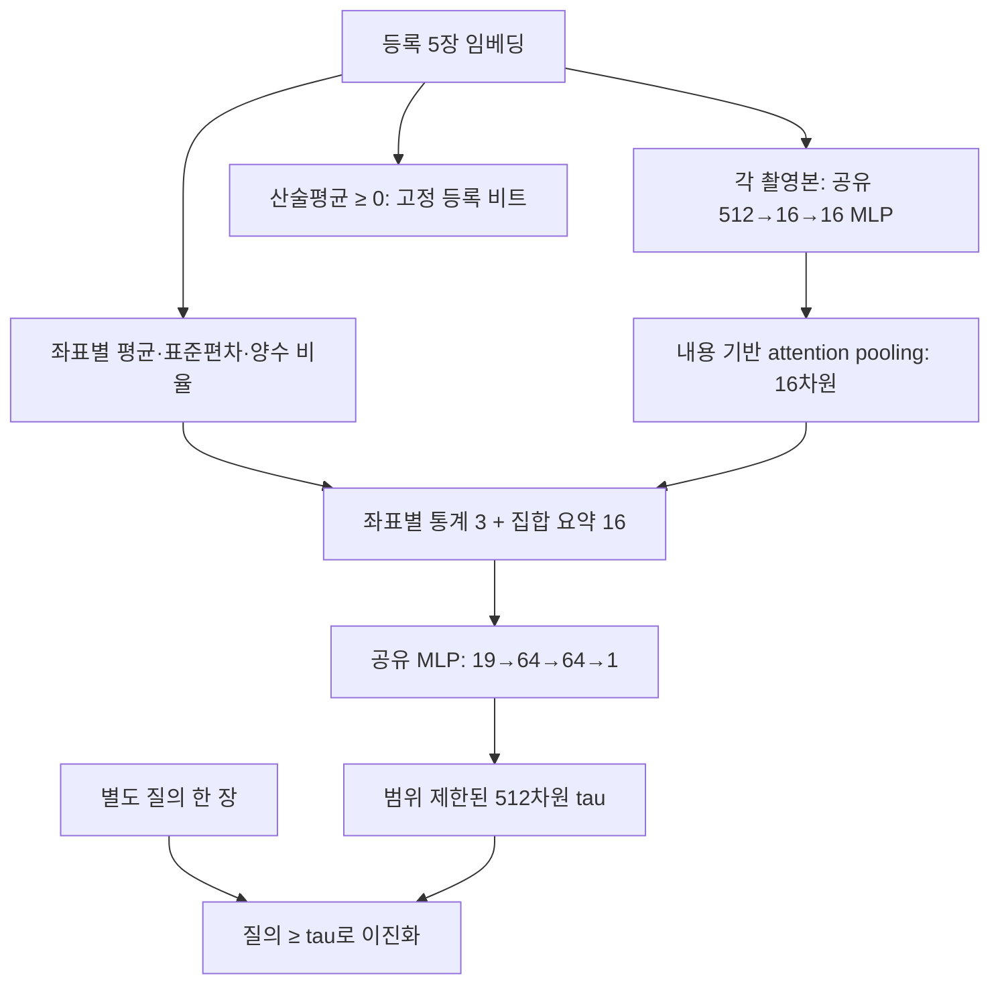

# S19: 신경망 Thresholding A/B/C/D 비교

기존 V5를 기준으로 **등록 집합 인코더**와 **복구 경계·성공 유지 손실**의 효과를
2×2로 비교합니다. C1의 분위수 계산이나 테이블 학습은 사용하지 않습니다.
공통 공격 평가 기능만 S16에서 재사용합니다. 기존 모델·실험 결과는 변경하지 않습니다.

| 조건 | 구조 | 10 epoch 이후 손실 |
|---|---|---|
| A | 기존 V5 차원별 공유 MLP, 폭 128 | 기존 V5-D 손실 |
| B | 등록 5장 집합 인코더 + 좌표별 공유 MLP | 기존 V5-D 손실 |
| C | A와 동일 | 복구 경계 + 기존 성공 유지 + BCE·타인·tau 정규화 |
| D | B와 동일 | C와 동일 |

이 A/B/C/D는 S11의 A/B/C/D와 다른 비교 조건입니다. S19-A는 S11-D의 구조·손실을
사용합니다. 이번에는 동일 epoch 예산과 아래의 공개 tau 선택 제약을 네 조건 모두에 적용합니다.

## 실행

### S19-D만 실행

이번 커밋의 재현 대상은 **D: 등록 집합 인코더 + 복구 경계·성공 유지 손실**입니다.
원실험의 공유 구현과 체크포인트 호환성을 유지하며, `--arms D`로 D만 학습합니다.
이 옵션을 생략하면 원래의 A/B/C/D 비교가 실행됩니다.

```bash
cd /home/uxm2/hsh/2026_2/multimodal_biometric
bash feature_extractors/run.sh -m scripts.s19_neural_threshold.train --arms D --check-only --device cpu
bash feature_extractors/run.sh -u -m scripts.s19_neural_threshold.train --arms D --device cuda --seeds 17 29 43
```

D만 실행하면 신경망 학습은 3회이며, best/last 및 두 대조군의 공개정보 공격·BCH 평가를
포함합니다. 동일 warm-up의 B/D 비교는 B도 실행한 경우에만 수행합니다.

필수 의존 파일로 루트 `Thresholding Model V5.py`, S11의 모델 연결·프로토콜·손실·평가·
실행 도구, S12의 진단·출력 경로 도구를 포함합니다. S16의 이미 공개된 공격 평가 도구도
재사용합니다. 다른 실험의 실행은 import만으로 시작되지 않으며 Fusion 의존성은 없습니다.
모델·손실·학습 설정은 원실험과 동일합니다.

새 환경에서는 루트 README의 데이터 준비 절차를 먼저 완료하고 `--source-run`과
`--embedding-dir`을 지정해야 합니다. 데이터셋·가중치·임베딩·체크포인트·결과는 커밋하지 않습니다.

**해석 주의:** 기존 S19-D의 epoch 100 모델은 공개 τ 공격으로 얼굴·지문 등록 비트의
BCH 복원 성공률이 모두 100%였습니다. 높은 정상 복구율을 안전한 공개 보조정보 설계의
성과로 해석하면 안 됩니다. 보안 제약으로 선택한 best는 세 seed 모두 epoch 0이었으며,
best와 last의 역할을 그대로 구분합니다.

### 원래의 A/B/C/D 비교 및 합성 테스트

```bash
cd /home/uxm2/hsh/2026_2/multimodal_biometric

# 읽기 전용: 기존 입력·분할·등록/질의 겹침 검사. 학습/결과 생성 없음.
bash feature_extractors/run.sh -m scripts.s19_neural_threshold.train --check-only --device cpu

# A/B/C/D × seed 17,29,43 = 12회; 실제 BCH와 독립 공격 평가 포함.
bash feature_extractors/run.sh -m scripts.s19_neural_threshold.train --device cuda

# 빠른 1 seed 비교: 그래도 A/B/C/D 네 조건 모두 실행.
bash feature_extractors/run.sh -m scripts.s19_neural_threshold.train --device cuda --seeds 17

# 합성 데이터 테스트만 실행.
bash feature_extractors/run.sh -m unittest scripts.s19_neural_threshold.test_experiment -v
```

실제 학습은 사용자가 실행합니다. 환경 설치·원본 데이터 변경·임베딩 재추출은 하지 않습니다.
기본 100 epoch에 첫 10 epoch를 포함하며 조기 종료는 없습니다. 모든 조건을 같은 길이로
학습하고 best.pt와 last.pt를 각각 남깁니다. `--epochs`를 줄일 때는 `--warmup-epochs`도
그보다 작게 지정합니다. `--no-bch-eval`을 명시한 경우만 실제 BCH를 생략합니다.
진행률·경과 시간·남은 시간은 신경망 학습/독립 공격 학습/최종 평가 단계별로 출력합니다.
전체 ETA 표시는 현재 단계의 관측 속도로 계산한 추정치이며 이후 단계의 시간을 확정하지 않습니다.

## 고정된 조건과 입력

- ArcFace/DeepPrint의 기존 정규화된 512차원 임베딩 캐시를 사용합니다.
- 등록은 모달리티별 5장, 질의는 등록에 포함되지 않은 나머지 사진을 각각 한 장씩 사용합니다.
- 기본 데이터는 MUCT 276명/3,755장, U.are.U 실제 7명/65손가락/520장입니다.
- 기존 사람 분할: 얼굴 train/validation/test = 220/28/28명, 지문 = 5/1/1명,
  손가락 = 50/10/5개입니다. 같은 사람의 손가락은 같은 분할입니다.
- 얼굴·지문 가상 대응은 실제 동일인 대응이 아닙니다. 두 신경망은 서로 독립입니다.
- 등록 기준 `c = 1[mean(enrollment_5) >= 0]`, BCH t=32, tau 범위 ±0.02,
  온도 0.02, optimizer Adam(lr=0.001), 손실·분할·촬영 계획을 공유합니다.
- τ는 모달리티마다 512차원입니다. 모든 조건은 모달리티당 float32 512개,
  즉 **16,384비트**를 저장합니다. 저장량 제한 bottleneck 실험은 여기에 포함하지 않습니다.
- 매 epoch 신원당 등록 집합 2개를 재표집합니다. 한 집합의 등록/질의는 겹치지 않으며,
  모든 조건과 seed가 동일한 epoch별 계획을 사용합니다. 신원별 가중치로 가상 대응의
  지문 중복을 보정합니다. ID는 샘플링/정답/평가용이며 모델 입력이 아닙니다.

## 모델

`model.py`에 Config와 NeuralThreshold가 있습니다. 입력은 각 `[B,5,512]`,
출력은 face_tau/finger_tau `[B,512]`와 고정 기준 비트, 학습용 soft bit 등입니다.



A/C는 기존 `3→128→128→1`의 차원별 공유 MLP입니다. B/D는 위 구조입니다.
입력 임베딩/평균/표준편차에는 기존처럼 sqrt(512) 배율을 적용합니다.
5장 순서에 대한 위치 인코딩은 없습니다. attention은 τ를 예측할 때만 사용하며
등록 기준 비트를 가중평균으로 바꾸지 않습니다. attention 가중치는 품질 정답이나
보정된 신뢰도 확률로 간주하지 않습니다. 사용자마다 추가 optimizer를 실행하지 않습니다.

마지막 층을 0으로 초기화해 모든 조건의 최초 τ는 정확히 0입니다. 첫 갱신은 출력층,
그 이후에는 집합 인코더와 attention에도 역전파가 전달됩니다.
얼굴·지문을 합친 기본 파라미터 수는 A/C 34,306개, B/D 28,004개입니다.
구조별 파라미터 수는 결과에도 기록합니다. 규모는 비슷하게 잡았지만 정확히 일치하지 않아
집합 구조의 효과와 파라미터 수의 효과를 완전히 분리한 비교는 아닙니다.

## 공통 warm-up과 고정 비교 모델

τ=0에서 이미 복구되는 얼굴 사례가 적으면 성공 유지 항이 거의 비활성일 수 있습니다.
따라서 각 구조는 먼저 기존 손실로 **10 epoch** 학습합니다. 그 모델을 복제해 동결한 후
11 epoch부터 C/D만 새 손실로 전환합니다. A/B는 기존 손실을 그대로 유지합니다.
100 epoch는 10+90이며, 별도로 10 epoch를 추가한 것이 아닙니다.

- A/C는 같은 초기 가중치·등록 계획·배치 순서·타인 추출 난수를 사용합니다. B/D도 같습니다.
- 각 조건을 독립 실행하지만 초기와 warm-up 종료의 state digest가 일치하는지 검사합니다.
- reference.pt는 **고정 epoch**의 모델이며 검증/시험 결과로 고르지 않습니다.
- reference는 TRAIN 등록으로만 τ를 만들고, 그 등록에 포함되지 않은 TRAIN 질의에서
  오류가 32 이하인 사례를 보호 대상으로 정합니다. 질의가 등록 τ 생성에 들어가지는 않습니다.
- 등록 집합이 매 epoch 바뀌므로 각 집합의 보호 대상은 같은 동결 모델로 다시 계산합니다.
- 보호 대상이 여전히 적으면 보호 비율을 보고하고, 효과가 확인됐다고 해석하지 않습니다.
- warm-up에서 선택된 best는 새 손실의 효과가 아닙니다. selected_origin과
  new_loss_selected를 별도로 기록합니다. 교사는 배포 모델에 포함하지 않습니다.

## 손실

모든 신경망은 실제 hard bit를 순전파에 쓰고 sigmoid 미분을 역전파에 쓰는 STE를 사용합니다.
T=0.02는 네 조건 모두 고정합니다. 새로운 이산 최적화 방식의 실험은 아닙니다.

```text
p = sigmoid((query - tau) / T)
b_STE = hard(query >= tau) + p - stop_gradient(p)
d = Hamming(b_STE, fixed_anchor)
d_ref = Hamming(hard(query >= frozen_reference_tau), fixed_anchor)

L_old = 0.1*BCE + mean((relu(d - 28)/32)^2)
        + L_negative + 0.001*mean((tau/0.02)^2)

L_boundary = mean(sigmoid((d - 32.5)/4))
L_keep = mean(1[d_ref <= 32] * (relu(d - 32)/32)^2)
L_new = 0.1*BCE + L_boundary + 1.0*L_keep
        + L_negative + 0.001*mean((tau/0.02)^2)
```

keep는 모든 본인 질의에 대한 평균이며 보호 대상만으로 재정규화하지 않습니다.
보호 대상이 없으면 정확히 0입니다. 보호는 손실상의 유도이며 성공 보장이 아닙니다.
새 손실은 경계 손실과 keep의 묶음 비교이므로 각각의 단독 효과는 분리하지 못합니다.
타인 손실은 기존처럼 인증 대상자의 τ로 타인 질의를 이진화하고, margin=96을 적용합니다.
기본 타인 8신원 중 가까운 타인/무작위 타인을 반씩 선택합니다. 사진 수가 다른 신원과
지문 가상 대응의 중복 가중치, 질의 padding 제외는 기존 V5와 동일합니다.

## 선택·분석·보안 진단

- 검증의 신원별 평균 `d<=32` 비율을 우선하고, 동률이면 평균 해밍거리 0.1비트 개선을 요구합니다.
- 기존 V5의 FAR·타인 하위 거리·AUROC·상수 좌표 제약을 네 조건에 동일하게 적용합니다.
  추가로 negative_sign/nonnegative_sign/zero_query의 공개 τ 복구율이 τ=0보다 증가하면 탈락합니다.
  이는 제한된 고정 공격 검사이며 보안 인증이 아닙니다.
- best는 epoch 0일 수 있습니다. last도 별도 진단하지만 test로 best를 바꾸지 않습니다.
- epoch마다 고정 TRAIN 집합에서 BCE/반경/경계/keep, 실제 HD·복구율, 고정 비교 모델 대비
  새로 성공한 수·기존 성공을 잃은 수·보호 비율을 기록합니다. 서로 다른 epoch의 재표집
  학습 loss만 비교하지 않습니다. monitor의 비교 모델은 warm-up 종료 전 τ=0, 이후 reference입니다.
- 모든 신경망과 독립 공격자의 학습/선택이 끝난 후 시험 평가를 시작합니다.
- 선택 best와 last 각각에 새 공격자 4개(coordinate linear/MLP, joint MLP,
  joint MLP+공개 BCH syndrome)를 학습합니다. τ=0과 의도적인 누출 양성 대조군도 평가합니다.
  기본 12회 학습 → 26개 endpoint → **104개 독립 공격자**, 공격자는 기본 50 epoch입니다.
- 공격자 예측에는 τ와 공개 sketch만 전달합니다. 실제 임베딩·등록 정답·ID는 예측 입력이 아닙니다.
  BCH syndrome을 MLP에 입력하는 검사는 대수적 syndrome 풀이 공격과 다릅니다.
- 공개 payload와 오프라인 정답/질의 비트 파일은 분리합니다. 공격 실패는 보안 증명이 아닙니다.
- 실제 BCH는 등록 **비트열**의 정확 복구를 측정합니다. 전체 FE의 키 복구 실험이 아닙니다.
- 동일 split의 여러 seed는 새로운 사람 분할이 아닙니다. 시험 분할의 반복 사용은 탐색 실험이며,
  지문 시험이 1명인 경우 사람 간 FAR은 null입니다.

기존의 bound_error_lower_bound도 보고합니다. ±0.02 내에서 오류 하한이 32를 넘는 질의는
이 범위를 유지하는 어떤 모델도 복구 반경 안으로 만들 수 없습니다. 범위 확대는 이번 비교에
섞지 않고 별도 실험으로 진행해야 합니다.

## 출력

`thresholding/results/neural_abcd_<시각>/`에 새 폴더를 만듭니다.

| 파일 | 내용 |
|---|---|
| comparison.csv / aggregate.csv | A/B/C/D, best/last, 모달리티별 복구·FAR·공격 결과 |
| attacks.csv / attack_aggregate.csv | 고정·독립 학습 공격과 실제 BCH 복구 결과 |
| models/A_seed17/{best,last,reference}.pt | 선택·마지막·동결 warm-up 모델 |
| models/*/history.jsonl | loss, 검증, 고정 TRAIN 성공/실패 전환, 선택 이유 |
| models/*/selection.json | 선택 epoch·어떤 손실 단계인지·보호 비율 |
| matched_warmup.json | A/C 및 B/D 초기·warm-up 동일성 검사 |
| models/*/{best,last}/{validation,test}/ | tau·기준/질의 비트·개별 거리·공개 payload |
| selection_complete.json | 시험 직전 동결된 모델·교사·공격자 해시 |
| config.json / source/ / protocols/ | 실행 인수·원본/코드 해시·등록/질의 계획 |

소스·입력·동결 체크포인트 해시를 종료 시 재검증합니다. 완료된 결과 폴더와
원본 데이터·기존 체크포인트는 덮어쓰지 않습니다.
